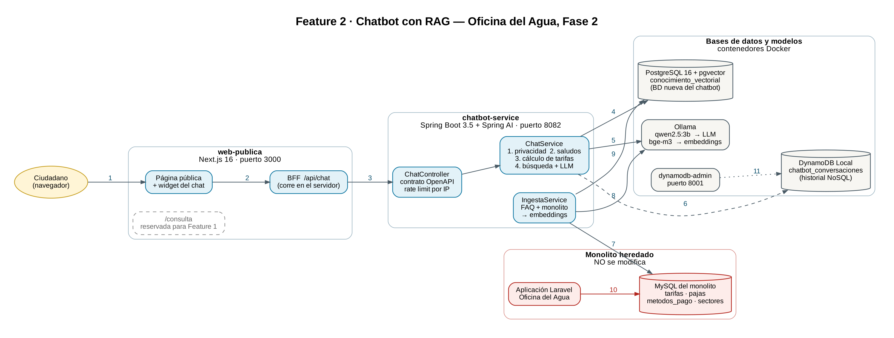

Nombre: Rudy Geovany González Arana
Carnet: 0905-23-6867
Repositorio: https://github.com/RudyGT05/rag-chatbot
Modulo asignado: Chatbot con RAG

# Oficina del Agua · Fase 2 — Feature 2: Chatbot con RAG

Asistente virtual para la **página pública** de la Oficina del Agua. Responde en
lenguaje natural preguntas sobre tarifas, formas de pago, trámites y fugas, usando
**solo información oficial**: un FAQ propio y los datos públicos del monolito
heredado, que se leen sin modificarlo.

**Contenido**

1. [Arquitectura de la solución](#1-arquitectura-de-la-solución)
2. [Módulo asignado: Chatbot con RAG](#2-módulo-asignado-chatbot-con-rag)
   - [2.1 Funcionalidad y objetivo](#21-funcionalidad-y-objetivo)
   - [2.2 Integración y responsabilidades](#22-integración-y-responsabilidades)
   - [2.3 Decisiones técnicas](#23-decisiones-técnicas)
   - [2.4 Instrucciones para probar el módulo](#24-instrucciones-para-probar-el-módulo)
3. [Seguridad de la información](#3-seguridad-de-la-información)
4. [Estructura del repositorio](#4-estructura-del-repositorio)
5. [Anexos: desarrollo, depuración y uso como librería](#5-anexos)
6. [Uso de IA en este proyecto](#6-uso-de-ia-en-este-proyecto)

---

## 1. Arquitectura de la solución

### 1.1 Contexto: monolito heredado y features de la Fase 2

- **Monolito heredado:** aplicación **Laravel** de la Oficina del Agua (clientes,
  contadores, lecturas, boletas, pagos y tarifas) con su base de datos **MySQL**.
  La regla de la Fase 2 es que **no se modifica**: las features nuevas se construyen
  alrededor de él.
- **Features nuevas de la Fase 2:** consulta pública con captcha, chatbot con RAG,
  envío de pagos a sistemas externos por colas y replicación asíncrona a NoSQL.
  Cada una la desarrolla un integrante en su propio repositorio.
- **Este repositorio** contiene la **Feature 2 (Chatbot con RAG)** completa:
  la página pública en Next.js con el widget del chat y su BFF, el microservicio
  Spring Boot, sus bases de datos y los modelos de IA. La página pública deja
  reservada la ruta `/consulta` para integrar la Feature 1.

### 1.2 Diagrama de arquitectura



> Fuente editable del diagrama: [`docs/arquitectura.dot`](docs/arquitectura.dot)
> (Graphviz: `dot -Tpng -Gdpi=150 docs/arquitectura.dot -o docs/arquitectura.png`).

### 1.3 Qué representa cada conexión

| # | Origen → destino | Qué viaja | Cuándo |
|---|---|---|---|
| 1 | Ciudadano → página pública | El usuario abre la página y escribe su pregunta en el widget | Cada pregunta |
| 2 | Widget → BFF `/api/chat` | `POST` con `{ "question": "..." }`, dentro del mismo Next.js | Cada pregunta |
| 3 | BFF → `chatbot-service` | `POST /api/v1/chat` por la red interna de Docker, con la IP real del usuario en `X-Forwarded-For` | Cada pregunta |
| 4 | `ChatService` → pgvector | Búsqueda de los 4 fragmentos más parecidos a la pregunta (similitud coseno) | Preguntas que llegan al RAG |
| 5 | `ChatService` → Ollama | Embedding de la pregunta con `bge-m3`, y luego la redacción de la respuesta con `qwen2.5:3b` | Preguntas que llegan al RAG |
| 6 | `ChatService` → DynamoDB | Registro de la conversación en otro hilo: el usuario no espera esta escritura | Cada pregunta |
| 7 | `IngestaService` → MySQL del monolito | `SELECT` sobre 4 tablas públicas, con usuario de solo lectura y conexión `readOnly` | Al arrancar y con `POST /api/v1/ingest` |
| 8 | `IngestaService` → Ollama | Embedding de cada fragmento del FAQ y del monolito | Durante la ingesta |
| 9 | `IngestaService` → pgvector | Inserta los fragmentos con su vector, después de borrar los del mismo origen | Durante la ingesta |
| 10 | Laravel → MySQL | El monolito sigue administrando sus datos como siempre | Operación normal del monolito |
| 11 | dynamodb-admin → DynamoDB | Interfaz web para consultar el historial | Revisión y demo |

### 1.4 Componentes

| Componente | Tecnología | Puerto | Responsabilidad |
|---|---|---|---|
| `web-publica` | Next.js 16, React 19 | 3000 | Página pública, widget del chat y BFF. Es el **único** servicio que ve el navegador |
| `chatbot-service` | Java 17, Spring Boot 3.5, Spring AI 1.0 | 8082 | API del chatbot: guardias, cálculo de tarifas, RAG, ingesta e historial |
| `postgres-vector` | PostgreSQL 16 + pgvector | 5433 | Base de datos **nueva** del chatbot: fragmentos de conocimiento y sus vectores |
| `ollama` | Ollama 0.9.6 | 11434 | Ejecuta localmente el LLM `qwen2.5:3b` y el modelo de embeddings `bge-m3` |
| `dynamodb-local` | Amazon DynamoDB Local | 8000 | Historial de conversaciones (NoSQL) |
| `dynamodb-admin` | dynamodb-admin | 8001 | Visor web del historial |
| `mysql-monolito` | MySQL 8.0 | 3307 | **Base de prueba** con la estructura real del monolito y datos ficticios (ver [`db/README.md`](db/README.md)) |

El chatbot puede leer la **réplica real** del monolito cambiando solo variables de
entorno (sección 3). Por defecto usa la base de prueba, así cualquiera puede
levantar el proyecto sin credenciales.

### 1.5 Ejecución

Requisitos: **Docker Desktop** y unos **8 GB de RAM** libres (Ollama carga los modelos en memoria).

```bash
git clone https://github.com/RudyGT05/rag-chatbot.git
cd rag-chatbot
docker compose up -d --build
docker compose logs -f chatbot-service
```

La **primera vez** tarda varios minutos: Ollama descarga los dos modelos
(unos 3 GB) y quedan guardados en un volumen para las siguientes veces. El servicio
está listo cuando el log muestra:

```
Ingesta completada: 27 fragmentos FAQ, 6 del monolito, ... ms
```

| Qué abrir | URL |
|---|---|
| Página pública con el chat (botón azul, abajo a la derecha) | http://localhost:3000 |
| Swagger UI del microservicio | http://localhost:8082/swagger-ui/index.html |
| Historial de conversaciones | http://localhost:8001 |

Para apagar todo: `docker compose down`. Para borrar también los datos y los
modelos descargados: `docker compose down -v`.

---

## 2. Módulo asignado: Chatbot con RAG

### 2.1 Funcionalidad y objetivo

**El problema.** La Oficina del Agua responde todos los días las mismas preguntas
por teléfono o en ventanilla: cuánto cuesta cada tipo de paja, cómo se calcula el
cobro, dónde y cómo pagar, qué documentos lleva un trámite y qué hacer ante una
fuga. El chatbot responde esas preguntas a cualquier hora desde la página pública,
sin login y sin exponer datos de ningún cliente.

**Qué construí.** Un asistente basado en **RAG** (*Retrieval-Augmented Generation*).
Un modelo de lenguaje no conoce la Oficina del Agua, así que en cada pregunta se le
entrega la información oficial relevante y se le indica que responda solo con ella.

**Cómo funciona.** Hay dos procesos.

**a) Ingesta**, al arrancar y con `POST /api/v1/ingest`. Llena la base vectorial:

1. `FaqLoader` lee los 5 archivos del FAQ (`chatbot-service/src/main/resources/conocimiento/*.md`)
   y los parte por secciones `##`: cada sección es una pregunta con su respuesta y
   se convierte en un **fragmento**, 27 en total.
2. Tres lectores consultan la base del monolito en solo lectura (tarifas y pajas,
   formas de pago, sectores) y `RedaccionMonolito` convierte cada fila en una
   **oración en español**, 6 fragmentos. Se redactan como oraciones para que se
   parezcan a cómo pregunta la gente.
3. `IngestaService` borra los fragmentos anteriores del mismo origen, para que una
   tarifa vieja no quede en el sistema, genera el **embedding** de cada fragmento
   con `bge-m3` (un vector de 1024 números que representa su significado) y lo
   guarda en pgvector.

**b) Respuesta a una pregunta**, en `ChatService.responder()`. La pregunta pasa por
cinco etapas en orden, y la primera que puede responderla termina el proceso:

| # | Etapa | Clase | Qué hace | Tipo en el historial |
|---|---|---|---|---|
| 1 | Privacidad | `DetectorConsultaCuenta` | Si pide datos de una cuenta ("¿cuánto debo?", un código de contador), responde con un texto fijo que remite a la Consulta pública | `PRIVACIDAD` |
| 2 | Cortesía | `DetectorCharla` | Si es solo un saludo, agradecimiento o despedida, responde sin buscar | `CHARLA` |
| 3 | Cálculo | `CalculadoraConsumo` | Si pregunta un precio o un cálculo de consumo, responde con las tarifas exactas leídas del monolito, con la fórmula del cobro | `CALCULO` |
| 4 | Búsqueda | `ChatService` + `FiltroRelevancia` | Convierte la pregunta en embedding y busca los 4 fragmentos más cercanos, con similitud mínima de 0.35, quedándose solo con los cercanos al mejor. Si no hay ninguno, responde que no tiene esa información **sin llamar al LLM** | `SIN_INFORMACION` |
| 5 | Generación | `ChatService` + Ollama | Arma un prompt con los fragmentos como CONTEXTO y `qwen2.5:3b` redacta la respuesta siguiendo reglas fijas: solo usar el contexto y no inventar montos, fechas ni requisitos | `RAG` |

Cada respuesta incluye sus **fuentes** (los fragmentos usados, con su similitud) y
se registra en DynamoDB con su tipo y su latencia.

### 2.2 Integración y responsabilidades

| Frontera | Decisión | Por qué |
|---|---|---|
| **Monolito heredado** | No se modifica. Se lee la réplica con un usuario que solo tiene `SELECT`, y además la conexión se abre en modo `readOnly` | Regla de la Fase 2. El doble candado garantiza que ni un error de código pueda escribir en él |
| **Datos que se leen del monolito** | Solo 4 tablas públicas: `tarifas`, `pajas`, `metodos_pago`, `sectores`. Nunca clientes, lecturas, boletas ni pagos | El chatbot es público y sin login: solo puede saber lo que estaría en un cartel de la oficina |
| **Navegador ↔ microservicio** | El navegador solo habla con Next.js. El BFF (`web-publica/app/api/chat/route.ts`) valida la pregunta y la reenvía al microservicio por la red interna | La URL del microservicio no llega al navegador (`server-only`), `POST /api/v1/ingest` no se expone al público y los errores técnicos se convierten en mensajes amables |
| **Next.js ↔ bases de datos** | Next.js no accede a ninguna base de datos | Toda la lógica y el acceso a datos quedan en el microservicio, detrás del contrato |
| **Modelos de IA** | Corren localmente en Ollama. No hay claves de API | Ninguna clave puede filtrarse al navegador ni al repositorio, no hay costo por pregunta y las preguntas no salen del servidor |
| **Base vectorial propia** | Postgres + pgvector en un contenedor nuevo, separado del MySQL del monolito | El monolito no se toca y MySQL no tiene búsqueda vectorial |
| **Feature 1 (consulta pública)** | Las preguntas sobre saldos y deudas se remiten a la sección "Consulta pública". La página reserva la ruta `/consulta` para esa feature | Cada feature conserva su responsabilidad: los datos de una cuenta solo se consultan con el código del contador y el captcha de la Feature 1 |
| **Contrato** | Contract-first: [`chatbot-api.yaml`](chatbot-service/src/main/resources/static/openapi/chatbot-api.yaml) genera las interfaces y DTOs, y los controladores las implementan | Si el contrato cambia, el código no compila hasta actualizarse: la API documentada y la real no pueden diferir |

### 2.3 Decisiones técnicas

#### Decisión principal: lo que debe ser exacto lo decide el código, no el LLM

Un LLM **predice texto, no calcula ni obedece reglas con garantía**. Lo comprobé en
las pruebas con `qwen2.5:3b`:

- Con el ejemplo correcto en su contexto, calculó mal un cobro: *"(36 − 30) = 12 → Q76.00"*.
- Ante *"¿cuánto vale 1/3 de paja?"*, **inventó** una tarifa (Q38.20, 20 m³) para un
  tipo de paja que no existe.
- Ante un simple *"Hola!"*, respondió el procedimiento de fugas, porque el embedding
  de un saludo igual queda cerca de algún fragmento.

**Alternativas consideradas:**

| Alternativa | Por qué la descarté |
|---|---|
| Endurecer el *system prompt* | Ya tenía la regla "nunca inventes montos" y aun así inventó. Un modelo pequeño no obedece siempre |
| Usar un modelo más grande (GPT-4, Claude) | Reduce el error, pero no lo elimina, y agrega costo por pregunta, dependencia de internet y una clave de API que proteger |
| Subir el umbral de similitud | Evita el caso del saludo, pero empieza a rechazar preguntas reales que hoy responde bien |
| **Guardias deterministas en código antes del LLM** (elegida) | Privacidad, saludos y montos se resuelven con reglas en Java que se cumplen el 100 % de las veces, con datos leídos directamente del monolito |

**Resultado:** los montos salen de `CalculadoraConsumo`, con la misma fórmula del
cobro (`monto_base + max(0, consumo − equivalencia_m3) × precio_m3_excedente`) y
las tarifas exactas del monolito. Un tipo de paja inexistente recibe *"No hay una
tarifa vigente para 1/3 de paja"* con la lista de las que sí existen. El LLM queda
solo para **redactar** información que ya está escrita en el contexto. De paso,
estas respuestas tardan milisegundos en lugar de los 5 a 15 segundos del LLM. El
system prompt conserva las mismas reglas como segunda capa de defensa.

#### Otras decisiones

| Decisión | Alternativa | Justificación |
|---|---|---|
| **RAG** en vez de reentrenar el modelo (*fine-tuning*) | Entrenar un modelo con los datos de la oficina | Una tarifa cambia y basta con reingestar en segundos. Reentrenar es caro y habría que repetirlo con cada cambio; además, el RAG permite citar las fuentes |
| **Ollama local** (`qwen2.5:3b` + `bge-m3`) | API de OpenAI u otro proveedor | Sin costo por pregunta, sin claves que proteger y los datos no salen del servidor. `bge-m3` es multilingüe y maneja bien el español |
| **pgvector** sobre PostgreSQL | Base vectorial dedicada (Pinecone, Qdrant) | Un motor SQL conocido, con índice HNSW, sin un servicio más que operar. Para cientos de fragmentos sobra |
| **Chunking por sección `##`** del FAQ | Partir por número de caracteres | Cada fragmento responde una sola pregunta. Un fragmento con varios temas queda "en medio" del mapa y empeora la búsqueda |
| **Filtro relativo** de relevancia (margen 0.05) | Solo el umbral fijo | Con tres procedimientos de fugas en el contexto, el modelo los mezclaba. El filtro deja solo los fragmentos cercanos al mejor |
| **DynamoDB** para el historial | Una tabla más en Postgres | Es un registro de eventos sin relaciones ni joins. El atributo `expiraEn` se declara como TTL para que cada conversación se borre sola a los 90 días. Se escribe en otro hilo: si DynamoDB falla, el chat sigue funcionando |
| **Empaquetado como librería** Spring Boot autoconfigurable | Solo microservicio | Puede integrarse dentro del backend de otra feature agregando una dependencia, o correr solo en Docker. Ver la sección 5.3 |

### 2.4 Instrucciones para probar el módulo

**Requisitos previos:** Docker Desktop. No hace falta ninguna credencial: por defecto
se usa la base de prueba del monolito (`db/`), con su estructura real y datos ficticios.

**1. Levantar los servicios**

```bash
docker compose up -d --build
docker compose logs -f chatbot-service
```

Espera a que aparezca `Ingesta completada: 27 fragmentos FAQ, 6 del monolito`.
La primera vez incluye la descarga de los modelos.

**2. Probar desde la página pública:** abre http://localhost:3000, haz clic en el
botón azul del chat y escribe estas preguntas. Las tarifas que aparecen son las de
la base de prueba.

| Pregunta | Resultado esperado | Tipo |
|---|---|---|
| `Hola!` | Saludo y lista de temas con los que ayuda | `CHARLA` |
| `¿Cuánto cuesta la media paja?` | *"La tarifa vigente de 1/2 paja es de Q28.00 al mes e incluye hasta 30 m³ de consumo. Cada metro cúbico adicional se cobra a Q4.00..."* | `CALCULO` |
| `tengo 1/2 paja y gasté 36 metros cúbicos` | Desglose del cálculo, total **Q52.00** (Q28.00 + 6 m³ × Q4.00) | `CALCULO` |
| `¿cuánto vale 1/3 de paja?` | *"No hay una tarifa vigente para 1/3 de paja..."* y la lista de las tarifas vigentes | `CALCULO` |
| `¿Cuánto debe el contador MTR-00012?` | No da datos: remite a la sección "Consulta pública" | `PRIVACIDAD` |
| `¿Qué hago si tengo una fuga en mi casa?` | Pasos a seguir redactados por el LLM, con fuentes del FAQ de fugas | `RAG` |
| `¿Dónde puedo pagar?` | Ventanilla de la oficina, horario y qué llevar | `RAG` |
| `¿Quién ganó el mundial?` | *"No tengo información sobre eso..."* (no inventa) | `SIN_INFORMACION` |

Las respuestas `RAG` tardan entre 5 y 20 segundos en una PC sin GPU; las demás,
milisegundos.

**3. Ver el historial:** abre http://localhost:8001, tabla `chatbot_conversaciones`.
Cada pregunta aparece con su respuesta, su **tipo** y su **latencia**. La IP no se
guarda, solo un hash.

**4. Probar la API y sus errores:** en Swagger (http://localhost:8082/swagger-ui/index.html)
o desde PowerShell:

```powershell
Invoke-RestMethod -Method Post -Uri http://localhost:8082/api/v1/chat `
  -ContentType "application/json" -Body '{"question":"cuanto cuesta la media paja"}'
```

| Prueba | Resultado esperado |
|---|---|
| `{"question":"ho"}` (menos de 3 caracteres) | `400 VALIDATION_ERROR` |
| 11 preguntas en menos de un minuto | `429 RATE_LIMITED` con el header `Retry-After` |
| `docker compose stop ollama` y preguntar algo de fugas | `503 LLM_UNAVAILABLE`. Las preguntas de precio siguen funcionando, porque no usan el LLM. Luego: `docker compose start ollama` |

**5. Comprobar que el chatbot sigue los datos del monolito:**

1. Pregunta *"¿cuánto cuesta la media paja?"*: responde **Q28.00**.
2. Simula que la oficina aprueba una tarifa nueva desde hoy. Esto se hace en la
   **base de prueba**, en el papel del monolito; el chatbot nunca escribe en ella:
   ```powershell
   docker exec chatbot-mysql-monolito mysql -uroot -proot oficina_agua -e "INSERT INTO tarifas (paja_id, monto_base, precio_m3_excedente, vigente_desde, created_at, updated_at) VALUES (2, 32.00, 4.5, CURRENT_DATE, NOW(), NOW());"
   ```
3. Reingesta: en Swagger, `POST /api/v1/ingest`. Responde `faqChunks: 27, monolitoChunks: 6`.
4. Repite la pregunta: ahora responde **Q32.00**.

   Para volver a la tarifa original, borra la fila de prueba y reingesta otra vez:
   ```powershell
   docker exec chatbot-mysql-monolito mysql -uroot -proot oficina_agua -e "DELETE FROM tarifas WHERE paja_id = 2 AND vigente_desde = CURRENT_DATE;"
   ```

---

## 3. Seguridad de la información

- **Sin secretos en el repositorio.** Las credenciales de la réplica real van en un
  archivo `.env` local, ignorado por git. [`.env.example`](.env.example) muestra solo
  los nombres de las variables. Las contraseñas que aparecen en `docker-compose.yml`
  y en `db/` pertenecen **únicamente a la base de prueba local** con datos ficticios.
- **Conectar la réplica real** solo requiere cambiar variables de entorno, sin tocar
  el código: `MONOLITO_DB_URL`, `MONOLITO_DB_USERNAME`, `MONOLITO_DB_PASSWORD`.
- **Monolito protegido:** usuario con solo `SELECT` y conexión `readOnly`.
- **Privacidad:** el conocimiento del chatbot solo contiene datos públicos, y la
  guardia de privacidad corre en código antes del LLM. El historial guarda un hash
  de la IP, nunca la IP.
- **Abuso:** límite de 10 preguntas por minuto por IP y validación de longitud en el
  BFF y en el contrato.
- **Errores:** respuestas con el esquema `Error` del contrato, sin *stack traces*.

---

## 4. Estructura del repositorio

```
rag-chatbot/
├── docker-compose.yml          # Toda la solución de la Feature 2
├── docker-compose.debug.yml    # Opcional: depurar con breakpoints (sección 5.2)
├── .env.example                # Variables para conectar la réplica real (sin valores)
├── docs/                       # Diagrama de arquitectura (PNG + fuente .dot)
├── db/                         # MySQL de prueba: estructura del monolito + datos ficticios
├── web-publica/                # Next.js: página pública, widget del chat y BFF
├── entrega-libreria/           # Guías para integrar el chatbot como librería
└── chatbot-service/            # Spring Boot
    ├── Dockerfile
    ├── pom.xml
    └── src/
        ├── main/resources/
        │   ├── conocimiento/*.md                 # FAQ: fuente 1 del RAG
        │   ├── static/openapi/chatbot-api.yaml   # El contrato
        │   ├── chatbot-defaults.properties       # Valores por defecto
        │   └── application-chatbot-standalone.yml
        ├── main/java/gt/edu/umg/desarrolloweb/chatbot/
        │   ├── controller/      # ChatController, IngestaController, manejo de errores
        │   ├── service/         # ChatService (RAG), IngestaService, guardias, filtro
        │   ├── conocimiento/    # FAQ, lectores del monolito, CalculadoraConsumo
        │   ├── historial/       # DynamoDB
        │   ├── config/          # Propiedades, conexiones, pgvector
        │   ├── autoconfigure/   # Autoconfiguración de la librería
        │   └── ratelimit/       # Límite de preguntas por IP
        └── test/                # Pruebas unitarias
```

Pruebas unitarias, sin instalar Maven:

```powershell
cd chatbot-service
docker run --rm -v "${PWD}:/app" -w /app maven:3.9-eclipse-temurin-17 mvn -q test
```

---

## 5. Anexos

### 5.1 Desarrollo

- Solo la infraestructura: `docker compose up -d postgres-vector ollama mysql-monolito dynamodb-local`.
- El código del contrato (`ChatApi`, `IngestaApi`, `*Dto`) se **genera** al compilar en
  `chatbot-service/target/generated-sources/openapi`.
- La página web sin Docker: ver [`web-publica/README.md`](web-publica/README.md).

### 5.2 Depuración con breakpoints (VS Code)

```powershell
docker compose -f docker-compose.yml -f docker-compose.debug.yml up -d chatbot-service
```

Abre el puerto 5005, solo en `localhost`, para conectar el depurador de Java de VS Code
con una configuración `attach` a `localhost:5005`. Para volver al modo normal:
`docker compose up -d chatbot-service`.

### 5.3 Uso como librería en otro proyecto Spring Boot

`mvn package` genera dos jars en `chatbot-service/target/`:

| Jar | Para qué |
|---|---|
| `chatbot-rag-1.0.0.jar` | **Librería** que otro proyecto agrega a su `pom.xml` |
| `chatbot-rag-1.0.0-exec.jar` | **Aplicación** que se ejecuta sola. La usa el `Dockerfile` |

Al agregar la dependencia, Spring Boot la descubre sola por
`META-INF/spring/...AutoConfiguration.imports`: no hace falta `@ComponentScan`. Para
no interferir con el proyecto anfitrión, sus conexiones están encapsuladas (no
publica ningún `DataSource`), sus valores por defecto tienen la prioridad más baja
y se puede apagar con `chatbot.enabled=false`. Guía completa:
[`entrega-libreria/INTEGRACION.md`](entrega-libreria/INTEGRACION.md) y
[`entrega-libreria/INTEGRACION-WEB.md`](entrega-libreria/INTEGRACION-WEB.md).

---

## 6. Uso de IA en este proyecto

El desarrollo y esta documentación se hicieron con apoyo de **Claude** (Anthropic)
como asistente. La IA revisó el código y la configuración del repositorio para
redactar la arquitectura, y cada afirmación de este documento se verificó contra el
código y contra pruebas ejecutadas: las respuestas de ejemplo, los conteos de
fragmentos y los códigos de error salen de ejecuciones reales. Los errores del LLM
descritos en la sección 2.3 (el cálculo equivocado, la tarifa inventada y el saludo
mal respondido) se encontraron probando el sistema, y cada uno dio origen a una
corrección en código con su prueba unitaria.
